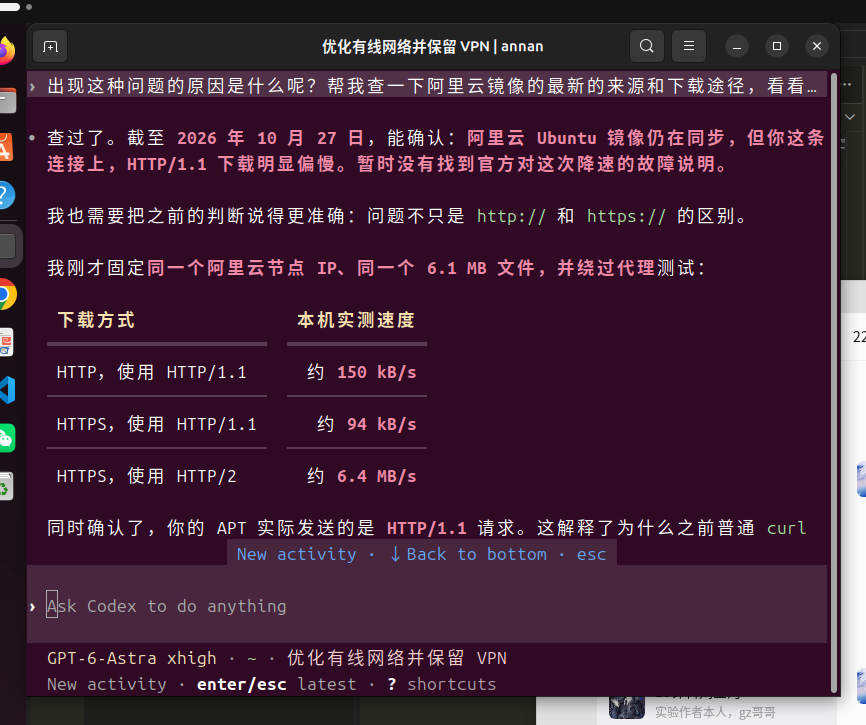

### 更新包管理器

更新包的时候，遇见了下载速度忒慢的问题，后来把阿里云换回了华为云，问题得到了解决。

gzgg告诉我说一个有关限速的问题：


巧合的是，我让codex自己查一下原因，得到了相同的结果：


### 验证基础环境

检查环境如下


### Rust开发环境准备

按照命令安装即可，然后在自己的repo中的00lab路径下（为了有toolchain）安装工具链


### 验证工作

可以验证一下文档说的python和make


### 安装Typst

可以用到下面的命令：

```shell
# 1. 下载官方安装包
cd ~
curl -fL https://github.com/typst/typst/releases/download/v0.15.1/typst-x86_64-unknown-linux-musl.tar.xz \
  -o typst-x86_64-unknown-linux-musl.tar.xz

# 2. 解压
tar -xf typst-x86_64-unknown-linux-musl.tar.xz

# 3. 安装到系统程序目录，并设置执行权限
sudo install -m 755 typst-x86_64-unknown-linux-musl/typst /usr/local/bin/typst

# 4. 刷新 Bash 命令路径缓存
hash -r

# 5. 验证安装
command -v typst
typst --version

```

