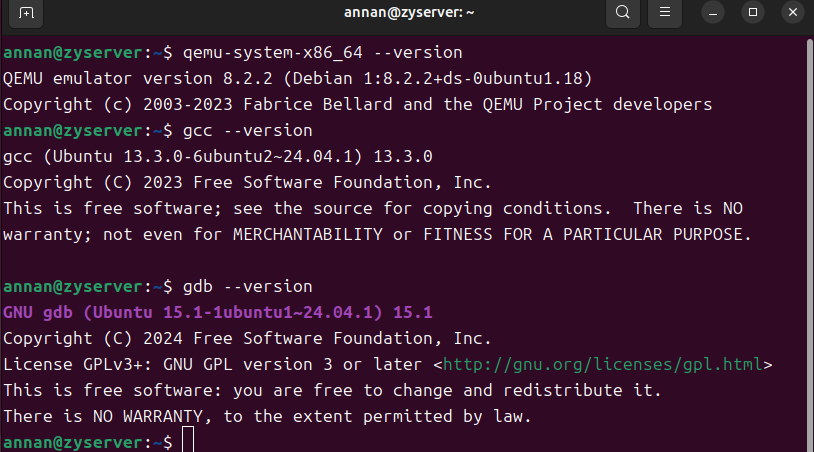
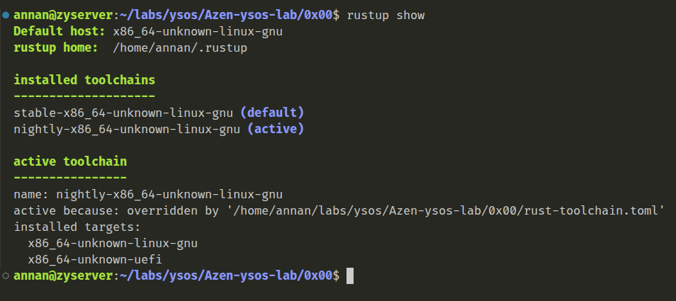
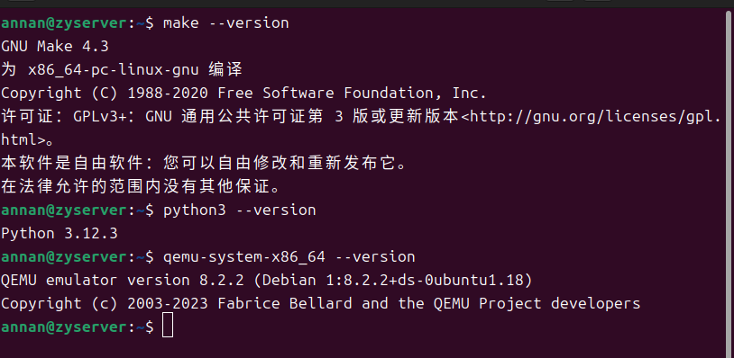

### 更新包管理器

更新包的时候，遇见了下载速度忒慢的问题，后来把阿里云换回了华为云，问题得到了解决。

gzgg告诉我说一个有关限速的问题：

巧合的是，我让codex自己查一下原因，得到了相同的结果：

### 验证基础环境

检查环境如下

### Rust开发环境准备

按照命令安装即可，然后在自己的repo中的00lab路径下（为了有toolchain）安装工具链

### 验证工作

可以验证一下文档说的python和make

